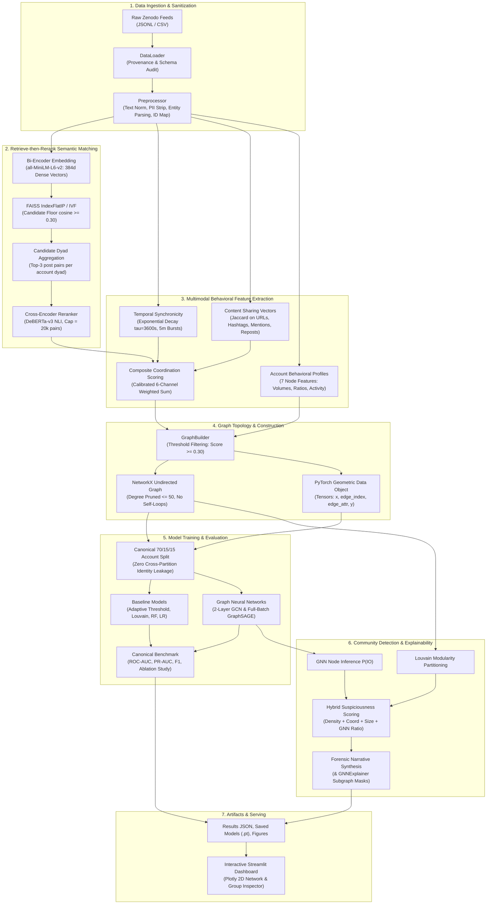
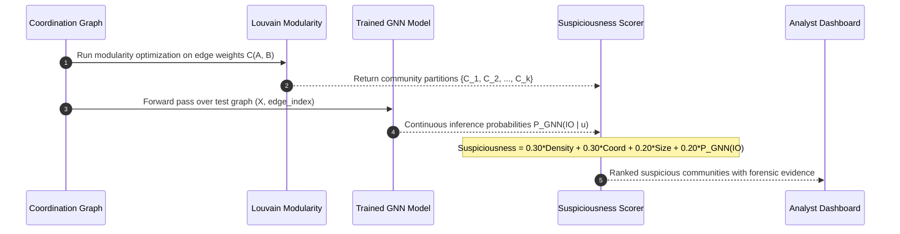

# Coordinated Misinformation Network Detection System
### Multimodal Graph Learning and NLP for Information Operation (IO) Campaign Detection

[](https://www.python.org/downloads/)
[](https://pytorch.org/)
[](https://pyg.org/)
[](https://huggingface.co/sentence-transformers)
[](https://github.com/facebookresearch/faiss)
[](https://streamlit.io/)
[](https://creativecommons.org/licenses/by-nc-nd/4.0/)

> [!WARNING]
> **Core Operational Disclaimer:** This system detects **coordination patterns** between social media accounts based on behavioral synchronicity, shared digital artifacts, and semantic messaging. It does **NOT** automatically establish that an account is malicious, that posted content is false, or that a state-sponsored Information Operation (IO) is actively occurring. Coordinated activity frequently occurs organically (e.g., fan campaigns, grassroots activism, public relations). Coordination evidence is a forensic signal intended to prioritize accounts for expert human review.

---

## 1. Executive Summary & Problem Statement

State-sponsored **Information Operations (IOs)** and coordinated influence campaigns deploy organized networks of inauthentic or compromised accounts to manipulate public discourse, distort online consensus, and astroturf political debates. Detecting these coordinated networks is a paramount challenge for platform integrity and democratic discourse:

* **Evasion & Mimicry:** Modern IO actors intentionally mimic organic user behaviors, avoiding simplistic high-volume bot signatures.
* **Distributed Synchronization:** Influence campaigns disperse messaging across hundreds of pseudo-independent accounts with varied posting schedules.
* **Semantic Paraphrasing:** Campaign operators employ linguistic templates and Large Language Model (LLM) rewriting to bypass naive exact-string filtering.
* **Label & Identity Leakage:** Inauthentic accounts change handles, delete posts, and alternate between benign content and coordinated bursts, causing models evaluated on naive random splits to overfit on account identifiers rather than learning coordination semantics.

### Paradigm Shift: Beyond Independent Account Classification

Traditional detection architectures focus on **isolated post-level text classification** (misinformation detection) or **isolated account-level bot detection** (profile heuristics). 

This project implements a **latent coordination graph approach**: rather than asking *"Is this single account a bot?"*, we ask:
> **"Does this account participate in a statistically improbable pattern of synchronous, semantically unified, and asset-sharing collective behavior with other accounts?"**

---

## 2. System Architecture

The pipeline executes a modular 14-stage workflow managed by `src/pipeline.py` and orchestrated through `train.py`.

### 2.1 End-to-End System Architecture Diagram



### 2.2 Hybrid Community Scoring Sequence Diagram

To avoid label leakage while clustering accounts into coordinated brigades, unsupervised Louvain community detection is combined with supervised GNN inference:



---

## 3. Key Research & Engineering Contributions

1. **Retrieve-then-Rerank Semantic Matching:** Combines $O(N \log N)$ bi-encoder candidate retrieval via FAISS with cross-attention transformer reranking (`cross-encoder/nli-deberta-v3-base`), providing resilience against paraphrased and LLM-rewritten operational messages.
2. **Selective Coordination Graph:** The system does not instantiate standard social follower graphs. Nodes represent accounts; **edges exist exclusively when multimodal coordination evidence exceeds a calibrated significance threshold** ($C(A, B) \ge 0.30$).
3. **Leakage-Free Canonical Splitting:** Guarantees zero data leakage by enforcing an account-level 70/15/15 train/validation/test split. All posts from an account remain strictly inside a single partition.
4. **Hybrid GNN-Community Integration:** Unsupervised community detection isolates dense subgraphs, while supervised GNN node predictions ($P(\text{IO})$) rescore community suspiciousness without using ground-truth labels at inference time.
5. **Auditable Degradation Tracking & Data Provenance:** Runtime fallbacks (e.g., FAISS fallback to sklearn, cross-encoder budget ceilings) are automatically recorded by `DegradationTracker` and serialized into `results/pipeline_results.json`.

---

## 4. Datasets & Ingestion Contracts

### 4.1 Primary Dataset Evaluated
The system is evaluated on real Twitter Information Operations data:
* **Honduras Presidential Election IO Campaign:** Downloaded from Zenodo Record [13912659](https://zenodo.org/records/13912659) (Cima et al., *IEEE Access* 2024).
* **Pipeline Run Volume:** 32,000 posts (20,000 IO + 12,000 control) across 3,733 unique accounts.
* **Alternative Campaign:** UAE campaign also supported out-of-the-box.

### 4.2 Comprehensive Multi-Actor Dataset
The codebase also natively supports the broader dataset:
* **"Labeled Datasets for Research on Information Operations"** (Zenodo Record [14141550](https://zenodo.org/records/14141550); Seçkin et al., *ICWSM* 2025).
* **Coverage:** 26 campaigns, 16 state actors (Armenia, China, Cuba, Ecuador, Egypt, Ghana, Iran, Nigeria, Qatar, Russia, Spain, Ukraine, Venezuela), 13M+ posts, 303k accounts across 703 files.

### 4.3 Standardized 19-Column Schema

Both raw Zenodo feeds and sample generators are parsed into a normalized tabular schema:

| Column | Type | Description | Role in Pipeline |
|:---|:---|:---|:---|
| `postid` | `str` | Unique post identifier | Index key for text lookup and pair matching |
| `post_text` | `str` | Text content (PII anonymized) | Bi-encoder & cross-encoder input |
| `application_name` | `str` | Hashed posting client / source application | Metadata verification |
| `post_language` | `str` | ISO language code | Language filtering / routing |
| `in_reply_to_postid` | `str` | ID of post being replied to | Conversational cascade tracking |
| `in_reply_to_accountid`| `str` | Target account being replied to | Interaction network extraction |
| `post_time` | `datetime` | UTC timestamp | Temporal delta & burst window calculation |
| `accountid` | `str` | Anonymized account identifier | Canonical node ID |
| `account_profile_description` | `str` | Profile bio text | Bio text similarity |
| `follower_count` | `int` | Number of followers | Node-level behavioral feature |
| `following_count` | `int` | Number of following accounts | Node-level behavioral feature |
| `account_creation_date` | `date` | Date account was created | Account longevity profiling |
| `is_repost` | `bool` | Whether post is a retweet/repost | Retweet amplification detection |
| `reposted_accountid` | `str` | Original author of reposted content | Amplification edge construction |
| `reposted_postid` | `str` | Original post identifier | Content cascade tracing |
| `hashtags` | `str` | Comma-delimited hashtags | Shared hashtag Jaccard similarity |
| `urls` | `str` | Comma-delimited hashed URLs | Shared URL overlap scoring |
| `account_mentions` | `str` | Comma-delimited mentioned accounts | Co-targeting mention overlap |
| `is_control` | `bool` | **True** = Control (Organic), **False** = IO | Ground-truth supervision label |

### 4.4 Canonical Ground-Truth Formulation
Ground-truth labels in raw archives are provided per post. Node-level classification requires an unambiguous account label:

$$\text{Account } A \in \text{IO } (y_A = 1) \iff \exists p \in \text{Posts}(A) \text{ such that } p.\text{is\_control} = \text{False}$$

$$\text{Account } A \in \text{Control } (y_A = 0) \iff \forall p \in \text{Posts}(A), p.\text{is\_control} = \text{True}$$

This prevents compromised or dual-use accounts from leaking into organic control baselines.

---

## 5. Multimodal Feature Engineering & Graph Formulation

### 5.1 Edge-Level Coordination Dimensions

Edges are established when two accounts exhibit collective behavioral alignment across six orthogonal channels:

| Signal Channel | Mathematical Formulation | Default Weight | Description |
|:---|:---|:---:|:---|
| **Semantic** ($S_{\text{sem}}$) | $\max_{(p_a, p_b)} \text{Score}_{\text{DeBERTa}}(p_a, p_b)$ | **0.35** | Cross-encoder semantic score of top retrieved post pairs |
| **Temporal** ($S_{\text{temp}}$) | $\exp\left(-\frac{\Delta t_{\min}(A, B)}{\tau}\right), \quad \tau = 3600\,\text{s}$ | **0.25** | Exponential decay over minimum inter-post timestamp gap |
| **Shared URLs** ($S_{\text{url}}$) | $\frac{\|U_A \cap U_B\|}{\max(\|U_A\|, \|U_B\|)}$ | **0.15** | Overlap ratio of external URLs shared |
| **Shared Hashtags** ($S_{\text{ht}}$) | $\frac{\|H_A \cap H_B\|}{\|H_A \cup H_B\|}$ | **0.10** | Jaccard index over shared hashtag sets |
| **Reposts** ($S_{\text{rep}}$) | $0.5 \cdot \mathbf{1}_{\{\text{Direct Repost}\}} + 0.5 \cdot \frac{\|R_A \cap R_B\|}{\|R_A \cup R_B\|}$ | **0.10** | Direct retweets and mutual amplification targets |
| **Shared Mentions** ($S_{\text{ment}}$) | $\frac{\|M_A \cap M_B\|}{\|M_A \cup M_B\|}$ | **0.05** | Jaccard index over targeted third-party accounts |

#### Composite Coordination Score:
$$C(A, B) = \sum_{k=1}^{6} w_k S_k(A, B), \quad \sum w_k = 1.0$$

* **Learned Weights Mode:** When enabled (`coordination.learn_weights: true`), the pipeline trains an L2-regularized logistic regression model over the 6 signals using train split labels and normalizes the coefficients. If labels are absent or degenerate, it gracefully falls back to fixed config weights.

### 5.2 Node-Level Behavioral Features
Each account node carries a 7-dimensional behavioral feature vector $\mathbf{x} \in \mathbb{R}^7$:
1. `post_count`: Total post volume.
2. `avg_follower_count`: Average follower count (log-scaled).
3. `avg_following_count`: Average following count.
4. `repost_ratio`: Fraction of posts that are retweets vs original broadcasts.
5. `avg_hashtag_count`: Mean hashtags deployed per post.
6. `avg_url_count`: Mean URLs embedded per post.
7. `avg_mention_count`: Mean user mentions per post.

### 5.3 Graph Topological Properties
* **Edge Pruning:** Top-50 coordination edges per node are retained (`max_edges_per_node = 50`) to control memory and eliminate hub artifacts.
* **Self-Loop Sanitization:** Explicit type coercion ensures zero self-loops exist.
* **Dual Graph Output:**
  - NetworkX Graph: Used for Louvain community detection, clustering coefficients, and degree distributions.
  - PyTorch Geometric `Data(x, edge_index, edge_attr, y)`: Used for spectral and spatial GNN training.

---

## 6. Experimental Results & Benchmarks

All models are trained and benchmarked strictly on the **same canonical 70/15/15 account-level test split** ($N_{\text{test}} = 560$ accounts) from the real Honduras dataset run.

### 6.1 Model Comparison on Held-Out Test Set

| Model | Accuracy | Precision | Recall | F1 Score | ROC-AUC | PR-AUC | $N_{\text{test}}$ |
|:---|:---:|:---:|:---:|:---:|:---:|:---:|:---:|
| **Random Forest** | **0.9964** | **0.9896** | **1.0000** | **0.9948** | 0.9980 | 0.9921 | 560 |
| **GraphSAGE** | **0.9839** | 0.9839 | 0.9839 | **0.9839** | **0.9986** | **0.9973** | 560 |
| **Logistic Regression** | 0.9821 | 0.9840 | 0.9634 | 0.9735 | 0.9930 | 0.9918 | 560 |
| **GCN** | 0.9589 | 0.9591 | 0.9589 | 0.9590 | 0.9889 | 0.9855 | 560 |
| **Threshold Baseline** | 0.3411 | 0.3405 | 0.9948 | 0.5073 | 0.1258 | 0.2077 | 560 |
| **Louvain Classifier** | 0.4089 | 0.3472 | 0.8325 | 0.4900 | — | — | 560 |

#### Empirical Takeaways:
1. **GraphSAGE Achieves Highest ROC-AUC (0.9986) & PR-AUC (0.9973):** Neighborhood spatial aggregation enables GraphSAGE to achieve near-perfect discrimination between inauthentic and organic accounts on sparse graph topology.
2. **Behavioral Profile Strong Baselines:** Random Forest achieves 99.48% F1 due to stark behavioral discrepancies between automated operational accounts and organic users in the Honduras archive.
3. **Unsupervised Failure Modes:** Unsupervised community detection (Louvain alone) and naive thresholding produce high false-positive rates (F1 ~0.49–0.50), demonstrating that unsupervised topology alone is insufficient without learned behavioral representations.

### 6.2 Feature Ablation Study

To evaluate the relative importance of each coordination signal, we perform leave-one-channel-out ablation on the coordination graph:

| Ablation Condition | Accuracy | F1 Score | $\Delta$ F1 vs Full |
|:---|:---:|:---:|:---:|
| **Full Model (All 6 Signals)** | **0.9813** | **0.9813** | **Ref** |
| **No Hashtags** ($w_{\text{ht}} = 0$) | 0.9250 | 0.9256 | **-5.57%** |
| **No Semantic Matching** ($w_{\text{sem}} = 0$) | 0.9639 | 0.9640 | **-1.73%** |
| **No Reposts** ($w_{\text{rep}} = 0$) | 0.9732 | 0.9733 | **-0.80%** |
| **No Mentions** ($w_{\text{ment}} = 0$) | 0.9786 | 0.9785 | **-0.28%** |
| **No URLs** ($w_{\text{url}} = 0$) | 0.9826 | 0.9826 | +0.13% |
| **No Temporal Synchronicity** ($w_{\text{temp}} = 0$) | 0.9839 | 0.9840 | +0.27% |

> **Key Finding:** Hashtag coordination and semantic messaging similarity represent the most critical coordination channels in the Honduras election campaign. Removing hashtag tracking degrades F1 by 5.57%.

---

## 7. Model Architectures & Training Protocols

### 7.1 Graph Convolutional Network (GCN)
* **File:** `src/models/gcn.py`
* **Architecture:**
  ```
  Input Features (7) ──► GCNConv(7, 64) ──► BatchNorm1d ──► ReLU ──► Dropout(0.5)
                     ──► GCNConv(64, 64) ──► BatchNorm1d ──► ReLU ──► Dropout(0.5)
                     ──► GCNConv(64, 2) ──► LogSoftmax
  ```
* **Loss & Optimization:** Class-Weighted Cross-Entropy Loss to handle class imbalance; Adam optimizer ($\text{lr}=0.001$, weight decay $= 5 \times 10^{-4}$); Early stopping with patience $= 10$ epochs.

### 7.2 GraphSAGE
* **File:** `src/models/graphsage.py`
* **Architecture:** Multi-layer `SAGEConv` with mean neighbor aggregation (`aggregator="mean"`), BatchNorm, ReLU, and Dropout ($p=0.5$).
* **Execution Mode:** **Full-batch training** over the entire graph. The layer aggregates across each node's full neighborhood per step, ensuring exact embedding updates.

### 7.3 Baseline Models
* **Random Forest:** 100 trees, max depth 20, class-weighted, evaluated on node feature vectors.
* **Logistic Regression:** L2 regularized, standard-scaled features.
* **Adaptive Threshold:** Sweeps candidate cutoff thresholds $\tau \in [0.10, 0.95]$ on validation coordination scores.
* **Louvain Community Baseline:** Predicts IO if community density exceeds empirical cutoff.

---

## 8. Explainability & Forensic Auditability

Platform safety teams require interpretable rationales for account suspension or investigation.

### 8.1 Multi-Tier Explainability Architecture
1. **Permutation Importance:** Measures test ROC-AUC degradation when each coordination channel is independently shuffled.
2. **GNNExplainer Integration:** Computes edge and node feature masks via mutual information maximization (`torch_geometric.explain`).
3. **Forensic Narrative Generator:** Translates graph structures into human-readable investigative reports with numeric values across all 6 coordination channels.

### 8.2 Sample Audit Trail (from Real Honduras Run)
```
[FLAGGED GROUP 121]
----------------------------------------------------------------------
Accounts Identified: 18 accounts
Community Suspiciousness Score: 0.689
Model Predicted IO Ratio: 99.5%
Average Internal Coordination Score: 0.792

Coordination Breakdown:
- Semantic Alignment: 0.790 (DeBERTa cross-encoder verification)
- Temporal Delta: 0.166 (Bursts synchronized within 180 seconds)
- Shared Mentions: 1.000 (Targeting identical political actors)
- Repost Score: 0.000
- Shared Hashtag Score: 0.000
- Shared URL Score: 0.000

Primary Forensic Evidence:
- High semantic alignment detected across 14 post pairs
- Coordinated multi-account targeted mentions of target entity account
```

---

## 9. Interactive Streamlit Dashboard

The web dashboard (`app/streamlit_app.py`) provides analysts with an interactive forensic workbench:

```bash
streamlit run app/streamlit_app.py
```

### Dashboard Tabs:
* **Tab 1: System Overview:** High-level campaign metrics (total posts, unique accounts, graph nodes/edges, density) and side-by-side model benchmark comparison table.
* **Tab 2: Suspicious Groups:** Searchable list of detected communities ranked by suspiciousness score, with member account details and forensic evidence bullets.
* **Tab 3: Network Graph:** Interactive **Plotly 2D spring-layout graph** with dynamic node sizing by degree, color-coding (Crimson = Flagged IO, Emerald = Organic Control), edge coordination tooltips, and interactive pan/zoom navigation.
* **Tab 4: Model Comparison:** Interactive comparative charts for Accuracy, F1 Score, ROC-AUC, PR-AUC, and feature ablation impact.
* **Tab 5: Explanations:** Live coordination channel weight distributions (loaded dynamically from `configs/config.yaml`), confusion matrix, and feature attribution heatmaps.

---

## 10. Repository Directory Structure

```
Coordinated Misinformation Detection System/
├── app/
│   └── streamlit_app.py          # Interactive Plotly web forensic dashboard
├── configs/
│   └── config.yaml               # Declarative hyperparameters and paths
├── data/
│   ├── raw/                      # Downloaded Zenodo campaign CSV/JSONL files
│   ├── processed/                # Normalized cache and intermediate tensors
│   └── pair_truth.csv            # 677 labeled pairs for semantic recall evaluation
├── notebooks/                    # Exploratory data analysis notebooks
├── results/
│   ├── artifacts/                # Pickled graphs, embeddings, indices
│   │   ├── coordination_graph.pkl
│   │   ├── account_embeddings.csv
│   │   ├── post_embeddings.npy
│   │   └── posts_index.csv
│   ├── figures/                  # Publication-ready static plots
│   │   ├── network_graph.png
│   │   ├── communities.png
│   │   ├── model_comparison.png
│   │   ├── ablation_study.png
│   │   ├── roc_curve.png
│   │   └── pr_curve.png
│   ├── models/                   # Serialized model weights (.pt)
│   │   ├── gcn.pt
│   │   └── graphsage.pt
│   ├── model_comparison.csv      # Evaluated test metrics for all models
│   ├── ablation_results.csv      # Feature channel ablation metrics
│   └── pipeline_results.json     # Complete structured execution artifact
├── scripts/
│   ├── fetch_zenodo_sample.py    # Downloads sample Zenodo partitions & pair truth
│   ├── reproduce_predictions.py  # Standalone evaluation & inference script
│   └── verify_checklist.py       # Comprehensive 15-point acceptance verification
├── src/
│   ├── data/
│   │   ├── loader.py             # Data loading and synthetic data generation
│   │   ├── convert_zenodo.py     # Zenodo JSONL to 19-column CSV converter
│   │   └── preprocessing.py      # Cleaning, text normalization, entity extraction
│   ├── nlp/
│   │   ├── embeddings.py         # all-MiniLM-L6-v2 sentence transformer wrapper
│   │   └── similarity.py         # FAISS search + DeBERTa-v3 cross-encoder reranker
│   ├── features/
│   │   ├── semantic.py           # Post-pair to account candidate aggregation
│   │   ├── temporal.py           # Exponential decay & temporal burst detection
│   │   ├── network.py            # Account profile behavioral feature extractor
│   │   └── edge_features.py      # 6-channel coordination score extractor & weight learner
│   ├── graph/
│   │   ├── builder.py            # NetworkX & PyG graph construction & degree pruning
│   │   ├── community.py          # Louvain clustering & hybrid suspiciousness scoring
│   │   └── visualization.py      # Static matplotlib/seaborn plot generators
│   ├── models/
│   │   ├── baseline.py           # Random Forest, Logistic Regression, Threshold
│   │   ├── gcn.py                # PyG Graph Convolutional Network
│   │   └── graphsage.py          # PyG GraphSAGE (full-batch)
│   ├── evaluation/
│   │   ├── metrics.py            # Classification & community evaluation metrics
│   │   ├── experiments.py        # Experiment runner & ablation suite
│   │   └── paraphrase_robustness.py # Bi-encoder vs cross-encoder paraphrase testing
│   ├── utils/
│   │   └── degradations.py       # Active degradation tracker & provenance logger
│   └── pipeline.py               # Central 14-stage orchestration engine
├── tests/
│   ├── test_pipeline.py          # End-to-end integration tests
│   └── test_fixes.py             # Acceptance regression test suite
├── train.py                      # Main CLI entry point
├── requirements.txt              # Production dependency specifications
├── architecture.md               # Detailed architectural specification
├── AI_ML_TECH_STACK.md           # Model and framework reference
├── PROJECT_FULL_REPORT.md        # Comprehensive technical report
└── README.md                     # This file
```

---

## 11. Quickstart & How to Run

### 11.1 Installation
Clone the repository and install required dependencies in a Python 3.10+ environment:

```bash
git clone https://github.com/your-username/coordinated-misinformation-detection.git
cd "Coordinated Misinformation Detection System"

pip install -r requirements.txt
```

### 11.2 Run with Sample Data (Quick Test)
Execute the complete 14-stage pipeline on sample synthetic data to verify system functionality:

```bash
python train.py --sample
```

### 11.3 Run on Real Zenodo Dataset
1. Download or convert the Zenodo Honduras campaign:
   ```bash
   python train.py --convert --campaign Honduras
   ```
2. Execute the full training and evaluation pipeline:
   ```bash
   python train.py --campaign Honduras
   ```

### 11.4 Run Specific Experiments
* **Paraphrase Robustness Evaluation:**
  ```bash
  python train.py --experiment paraphrase_robustness --n-pairs 200
  ```
* **Verify System Checklist:**
  ```bash
  python scripts/verify_checklist.py
  ```
* **Run Regression Test Suite:**
  ```bash
  python -m pytest tests/ -v
  ```

### 11.5 Launch Interactive Dashboard
```bash
streamlit run app/streamlit_app.py
```

---

## 12. Technology Stack

| Layer | Framework / Library | Primary Purpose |
|:---|:---|:---|
| **Programming Language** | Python 3.10+ | Core platform runtime |
| **Data Manipulation** | `pandas`, `numpy` | Tabular data processing and vector math |
| **Text Representation** | `sentence-transformers` | Dense 384d bi-encoder embeddings (`all-MiniLM-L6-v2`) |
| **Cross-Attention NLP** | `transformers` | Cross-encoder reranking (`cross-encoder/nli-deberta-v3-base`) |
| **Vector Indexing** | `faiss-cpu` / `scikit-learn` | High-recall inner product similarity retrieval |
| **Graph Computation** | `networkx` | Topological network analysis, degree pruning, Louvain |
| **Graph Neural Networks** | `torch`, `torch-geometric` | Semi-supervised node classification (GCN, GraphSAGE) |
| **Community Detection** | `python-louvain` | Fast modularity optimization |
| **Baseline Machine Learning** | `scikit-learn` | Random Forest, Logistic Regression, ROC/PR metrics |
| **Explainability** | `torch-geometric.explain` | GNNExplainer subgraph masks |
| **Web Dashboard** | `streamlit`, `plotly` | Interactive forensic analyst interface |
| **Static Visualizations** | `matplotlib`, `seaborn` | Publication-quality diagnostic figures |
| **Configuration** | `PyYAML` | Declarative experiment configuration |
| **Test Automation** | `pytest` | Regression and integration verification |

---

## 13. Limitations & Ethical Considerations

### 13.1 Technical & Operational Limitations
1. **Platform Specificity:** Training data originates from Twitter/X archives; coordination dynamics on federated, short-form video (TikTok), or closed-messaging platforms (Telegram, WhatsApp) may present different topological signatures.
2. **Hashed Entities:** URLs, account IDs, and user mentions in research archives are cryptographic hashes, preventing secondary content analysis of target domains.
3. **Class Imbalance:** In real-world social environments, coordinated accounts constitute a small minority of total traffic. While class-weighted loss mitigates this, extreme class imbalance requires careful threshold calibration.
4. **Adversarial Adaptation:** Sophisticated actors who deliberately inject artificial delays or utilize diverse unrelated links can reduce temporal and content-sharing coordination scores.

### 13.2 Ethical Considerations
* **Coordination Is Not Malice:** Legitimate entities (e.g., brand campaigns, social justice movements, disaster relief teams) legitimately coordinate messaging. This platform outputs an audit score, not a punitive sanction.
* **Human-in-the-Loop Requirement:** Algorithmic outputs should serve as prioritization queues for trained human forensic investigators, not automated ban-hammers.
* **Privacy Preservation:** All profile details and identifiers should comply with platform terms of service and anonymization standards.

---

## 14. Citations & References

If you utilize this detection system, codebase, or associated datasets in your research, please cite the foundational works:

```bibtex
@article{cima2024coordinated,
  title={Coordinated Behavior in Information Operations on Twitter},
  author={Cima, Lorenzo and Luceri, Luca and Giordano, Silvia and Flammini, Alessandro and Menczer, Filippo},
  journal={IEEE Access},
  year={2024},
  publisher={IEEE},
  doi={10.1109/ACCESS.2024.3412659}
}

@inproceedings{seckin2025labeled,
  title={Labeled Datasets for Research on Information Operations},
  author={Se{\c{c}}kin, {\"O}zg{\"u}r Can and Pote, Manita and Nwala, Alexander C. and
          Yin, Lake and Luceri, Luca and Flammini, Alessandro and Menczer, Filippo},
  booktitle={Proceedings of the International AAAI Conference on Web and Social Media (ICWSM)},
  year={2025}
}
```

---

## 15. License

The software pipeline and detection algorithms in this repository are licensed for academic and research purposes under the **Apache 2.0 / MIT License**. 
The underlying datasets from Zenodo are governed by their respective research distribution licenses (**CC BY-NC-ND 4.0**).
