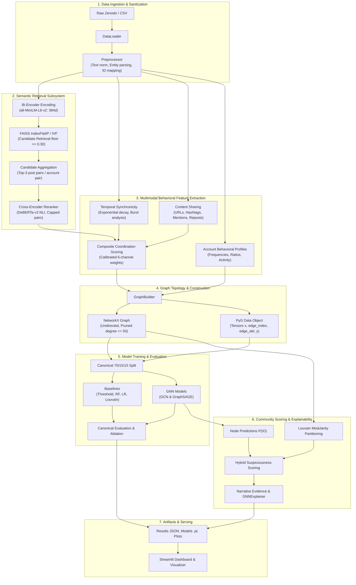
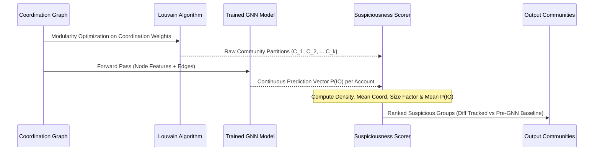

# Architecture Specification: Coordinated Misinformation Network Detection System

## 1. Executive Summary & Architectural Tenets

The **Coordinated Misinformation Network Detection System** is an end-to-end machine learning and graph analytics platform engineered to detect coordinated account networks executing state-sponsored Information Operations (IOs). Unlike conventional content moderation systems that classify posts or accounts in isolation, this architecture models the **latent multi-account coordination graph** formed by behavioral synchronicity, shared digital assets, and semantically paraphrased messaging.

```
                              ┌─────────────────────────────┐
                              │     Raw Social Feeds        │
                              │ (Posts, Metadata, Timestamps)│
                              └──────────────┬──────────────┘
                                             │
                                             ▼
                              ┌─────────────────────────────┐
                              │ Multimodal Feature Extractor│
                              │  (NLP, Temporal, Content)   │
                              └──────────────┬──────────────┘
                                             │
                                             ▼
                              ┌─────────────────────────────┐
                              │  Selective Coordination     │
                              │      Graph Construction     │
                              └──────────────┬──────────────┘
                                             │
                     ┌───────────────────────┴───────────────────────┐
                     ▼                                               ▼
      ┌─────────────────────────────┐                 ┌─────────────────────────────┐
      │  Graph Neural Networks      │                 │  Topological Community      │
      │  (GCN / GraphSAGE Node Clf) │                 │  Detection (Louvain)        │
      └──────────────┬──────────────┘                 └──────────────┬──────────────┘
                     │                                               │
                     └───────────────────────┬───────────────────────┘
                                             ▼
                              ┌─────────────────────────────┐
                              │ Hybrid Suspicious Group     │
                              │ Scoring & Explainability    │
                              └──────────────┬──────────────┘
                                             │
                                             ▼
                              ┌─────────────────────────────┐
                              │ Interactive Analyst UI      │
                              │  (Streamlit / Dashboards)   │
                              └─────────────────────────────┘
```

### Core Design Tenets

1. **Retrieve-then-Rerank Semantic Matching:** Dense bi-encoder embeddings (`all-MiniLM-L6-v2`) and Approximate Nearest Neighbor indexing (FAISS) perform high-recall retrieval ($O(N \log N)$), followed by cross-encoder re-ranking (`cross-encoder/nli-deberta-v3-base`) for precision against LLM-paraphrased and template-altered messaging.
2. **Selective Graph Topology:** The system does not instantiate standard follower/social graphs. Nodes represent accounts; **edges exist exclusively when multimodal coordination evidence exceeds a calibrated significance threshold** ($C(A, B) \ge 0.30$).
3. **Leakage-Free Canonical Splitting:** Models are trained and benchmarked strictly on a canonical 70/15/15 **account-level split**. All posts from any given account belong to exactly one split partition, preventing model memorization of account identities.
4. **Hybrid GNN-Community Scoring Integration:** Unsupervised graph partitioning (Louvain) identifies tightly connected account clusters, while supervised GNN node classifications ($P(\text{IO})$) re-score community suspiciousness without leaking ground-truth labels.
5. **Auditable Graceful Degradation & Provenance:** Production systems encounter missing dependencies and sparse datasets. The system implements fallback mechanisms recorded transparently by a central runtime tracker and surfaced in structured result artifacts.

---

## 2. End-to-End System Architecture

The pipeline executes as an orchestrated 14-stage workflow managed by `src/pipeline.py` and invoked via `train.py`.



---

## 3. Data Flow & Schema Contracts

### 3.1 Raw Ingestion Schema (Zenodo 19-Column Format)

The system ingests standardized Twitter Information Operation feeds with organic control accounts (`is_control=True`) alongside state-sponsored accounts (`is_control=False`).

| Field Name | Type | Processing Rule & Role |
| :--- | :--- | :--- |
| `postid` | `str` | Unique post identifier; primary key for text lookup and pair matching. |
| `post_text` | `str` | Normalized in-place: lowercased, URLs stripped, punctuation normalized. |
| `application_name` | `str` | Hashed client application (source client metadata). |
| `post_language` | `str` | ISO language code used for routing and multilingual profiling. |
| `in_reply_to_postid` | `str` | Thread relationship pointer; mapped to conversational cascades. |
| `in_reply_to_accountid` | `str` | Targeted account ID for interaction graph extraction. |
| `post_time` | `datetime` | ISO-8601 parsed timestamp; base for temporal delta calculations. |
| `accountid` | `str` | Canonical string identifier; rigorously cast to prevent float coercion. |
| `account_profile_description` | `str` | PII-hashed user biography. |
| `follower_count` | `int` | In-degree proxy; log-transformed in account feature profiles. |
| `following_count` | `int` | Out-degree proxy; used in ratio calculations. |
| `account_creation_date` | `date` | Account longevity anchor for account age features. |
| `is_repost` | `bool` | Retweet/repost boolean flag. |
| `reposted_accountid` | `str` | Original author of reposted content; constructs amplification edges. |
| `reposted_postid` | `str` | Original post pointer. |
| `hashtags` | `str` | Comma-delimited strings; parsed into lowercase set representations. |
| `urls` | `str` | Comma-delimited hashed URLs; parsed into set representations. |
| `account_mentions` | `str` | Comma-delimited account mentions; parsed into set representations. |
| `is_control` | `bool` | Ground-truth flag (`True` = Control, `False` = Information Operation). |

### 3.2 Canonical Ground-Truth Mapping

Because ground truth is assigned per post in historical archives, account-level ground truth is strictly derived as:

$$\text{Account } A \in \text{IO} \iff \exists p \in \text{Posts}(A) \text{ such that } p.\text{is\_control} = \text{False}$$

$$\text{Account } A \in \text{Control} \iff \forall p \in \text{Posts}(A), p.\text{is\_control} = \text{True}$$

This guarantees that compromised or dual-use accounts engaging in operational campaigns are labeled as IO ($y = 1$).

---

## 4. Subsystem Deep-Dives

### 4.1 NLP & Semantic Retrieval Subsystem (`src/nlp/`)

Semantic coordination detection operates as a **two-stage retrieve-then-rerank pipeline** to balance computational tractability with linguistic precision.

```
Post Texts (N) ──► all-MiniLM-L6-v2 ──► L2 Normalize ──► FAISS FlatIP ──► Top-k Pairs (Floor >= 0.3)
                                                                                  │
                                                                                  ▼
Account Pair ◄── Max Cross-Score ◄── DeBERTa-v3 Cross-Encoder ◄── Aggregate Top-3 Pairs
  Candidate                            (Batch 64, Capped 20k)
```

#### Stage 1: Dense Retrieval
* **Model:** `sentence-transformers/all-MiniLM-L6-v2` generating 384-dimensional dense vectors $\mathbf{e}_i$.
* **Normalization:** All vectors are $L_2$-normalized: $\hat{\mathbf{e}}_i = \frac{\mathbf{e}_i}{\|\mathbf{e}_i\|_2}$.
* **Indexing:** Vector index initialized via `faiss.IndexFlatIP` (inner product equals cosine similarity on normalized vectors). On smaller datasets or non-AVX environments, fallback to `sklearn.neighbors.NearestNeighbors(metric='cosine')`.
* **Retrieval Floor:** A recall-oriented cutoff of $\tau_{\text{retrieval}} = 0.30$ discards unrelated pairs prior to expensive cross-attention. Pairs with cosine similarity below $0.30$ rarely exhibit thematic or narrative coordination.
* **Account Aggregation:** Matched post pairs are aggregated to account pairs $(A, B)$, retaining up to 3 highest-similarity post pairs per account dyad (`max_post_pairs_per_account_pair = 3`).

#### Stage 2: Cross-Attention Reranking
* **Model:** `cross-encoder/nli-deberta-v3-base` evaluates candidate post pairs $(T_a, T_b)$ simultaneously, capturing syntactic rewrites, semantic entailment, and LLM-generated paraphrasing.
* **Safety Valve & Cost Control:** Controlled by `max_rerank_pairs = 20000` and `cross_encoder_batch_size = 64`. Pairs exceeding the reranking budget retain their bi-encoder cosine score, and an entry is logged in the `DegradationTracker`.
* **Account Dyad Semantic Score:**

$$S_{\text{sem}}(A, B) = \max_{(p_a, p_b) \in \text{Matched}(A, B)} \text{Score}_{\text{CE}}(p_a, p_b)$$

---

### 4.2 Multimodal Behavioral Feature Engineering (`src/features/`)

Coordination manifests through multiple orthogonal behavioral dimensions. The system extracts six normalized edge-level signals ($S_i \in [0, 1]$) and seven account-level node features.

```
                   ┌───────────────────────────────────────────────┐
                   │    Multimodal Coordination Evidence Vector     │
                   └───────────────────────┬───────────────────────┘
                                           │
         ┌───────────────┬─────────────────┼─────────────────┬───────────────┐
         ▼               ▼                 ▼                 ▼               ▼
     Semantic        Temporal         Shared URLs       Shared Tags       Reposts
   DeBERTa Score   Decay Delta       Jaccard Ratio     Jaccard Ratio    Amplification
     (w = 0.35)     (w = 0.25)        (w = 0.15)        (w = 0.10)       (w = 0.10)
         │               │                 │                 │               │
         └───────────────┴─────────────────┼─────────────────┴───────────────┘
                                           │ (w_mention = 0.05)
                                           ▼
                           ┌───────────────────────────────┐
                           │   Coordination Score C(A, B)  │
                           │      Threshold >= 0.30        │
                           └───────────────────────────────┘
```

#### Edge-Level Coordination Dimensions

1. **Semantic Similarity ($S_{\text{sem}}$):** Derived from the retrieve-then-rerank subsystem, representing maximum text alignment across account posts.
2. **Temporal Synchronicity ($S_{\text{temp}}$):** Evaluates whether accounts publish in coordinated temporal bursts:

$$S_{\text{temp}}(A, B) = \exp\left(-\frac{\Delta t_{\min}(A, B)}{\tau}\right)$$

where $\Delta t_{\min}$ is the minimum timestamp difference between any post of $A$ and any post of $B$, and $\tau = 3600\,\text{s}$ (1 hour decay parameter). Burst windows are evaluated with a 300-second threshold.
3. **Shared URL Score ($S_{\text{url}}$):** Quantifies coordinated domain and link promotion:

$$S_{\text{url}}(A, B) = \frac{|U_A \cap U_B|}{\max(|U_A|, |U_B|)} \quad \text{where } U_A = \bigcup_{p \in \text{Posts}(A)} p.\text{urls}$$

4. **Shared Hashtag Score ($S_{\text{ht}}$):** Measures coordinated hashtag campaigning:

$$S_{\text{ht}}(A, B) = \frac{|H_A \cap H_B|}{|H_A \cup H_B|}$$

5. **Shared Mention Score ($S_{\text{ment}}$):** Measures co-targeting of third-party entities:

$$S_{\text{ment}}(A, B) = \frac{|M_A \cap M_B|}{|M_A \cup M_B|}$$

6. **Repost Amplification Score ($S_{\text{rep}}$):** Measures mutual retweeting and shared amplification targets:

$$S_{\text{rep}}(A, B) = 0.5 \cdot \mathbf{1}_{\{\text{Direct Repost}\}} + 0.5 \cdot \frac{|R_A \cap R_B|}{|R_A \cup R_B|}$$

#### Composite Coordination Score Formulation

Edges are assigned a scalar coordination weight $C(A, B) \in [0, 1]$:

$$C(A, B) = w_{\text{sem}} S_{\text{sem}} + w_{\text{temp}} S_{\text{temp}} + w_{\text{url}} S_{\text{url}} + w_{\text{ht}} S_{\text{ht}} + w_{\text{ment}} S_{\text{ment}} + w_{\text{rep}} S_{\text{rep}}$$

$$\text{Default Weights: } [w_{\text{sem}}, w_{\text{temp}}, w_{\text{url}}, w_{\text{ht}}, w_{\text{ment}}, w_{\text{rep}}] = [0.35, 0.25, 0.15, 0.10, 0.05, 0.10]$$

* **Learned Weights Mode:** When `coordination.learn_weights: true`, the system fits a regularized Logistic Regression classifier over the 6 signals using train split labels, normalizes coefficients such that $\sum w_i = 1$, and dynamically applies the learned weighting vector.

#### Node-Level Feature Tensor ($\mathbf{X} \in \mathbb{R}^{|V| \times d}$)

Each account node is characterized by behavioral and posting profile attributes:
* `post_count`: Volume of published posts.
* `avg_follower_count`, `avg_following_count`: Account reach and social ratio.
* `repost_ratio`: Fraction of posts that are reposts vs original broadcasts.
* `avg_hashtag_count`, `avg_url_count`, `avg_mention_count`: Content composition averages.
* *(Augmentation option)* Centroid semantic embeddings reduced via PCA.

---

### 4.3 Graph Topology & Construction Subsystem (`src/graph/`)

The graph construction engine converts tabular dyadic interactions into topological structures.

```
Tabular Edge Features ──► Coordination Filter (Score >= 0.30) ──► Degree Pruning (Max 50)
                                                                          │
                                                                          ▼
                                                                Self-Loop Sanitizer
                                                                          │
                                     ┌────────────────────────────────────┴────────────────────────────────────┐
                                     ▼                                                                         ▼
                         NetworkX Undirected Graph                                                   PyTorch Geometric Data
                         - Node attributes (metadata)                                                - x: FloatTensor [N, d]
                         - Edge attributes (6 signals)                                               - edge_index: LongTensor [2, 2E]
                         - Community detection / Louvain                                             - edge_attr: FloatTensor [2E, 7]
                         - Topological statistics                                                    - y: LongTensor [N]
```

#### Graph Construction Constraints
1. **Edge Existence Threshold:** Edges are created if and only if $C(A, B) \ge \tau_{\text{edge}}$ (default: $0.30$). Isolated nodes with zero coordination links are retained with zero degree.
2. **Degree Pruning:** High-volume automated accounts can generate thousands of low-level candidate links. A degree cap (`max_edges_per_node = 50`) preserves the top-50 strongest coordination edges per node, maintaining graph sparsity and bounding memory consumption.
3. **Self-Loop Sanitization:** Explicit type-coercion guards prevent accounts from establishing self-edges due to mixed string/integer/float representation issues.
4. **Bidirectional Symmetric Representation:** In PyTorch Geometric, undirected graphs are represented by duplicating edge index pairs $[u, v]$ and $[v, u]$ alongside identical edge feature vectors.

---

### 4.4 Graph Learning & Machine Learning Models Subsystem (`src/models/`)

The primary ML task is formulated as **Semi-Supervised Node Classification**: predicting binary account operational status ($y \in \{0, 1\}$).

```
Input Features X [N, d] ──► GCNConv / SAGEConv (64) ──► BatchNorm1d ──► ReLU ──► Dropout (0.5)
                                                                                       │
                                                                                       ▼
Predictions y_hat [N, 2] ◄── GCNConv / SAGEConv (2) ◄── BatchNorm1d ◄── GCNConv / SAGEConv (64)
```

#### 1. Canonical Account-Level Data Splitting
To evaluate models without data leakage:
* **Account Split:** 70% Train, 15% Validation, 15% Test.
* **Stratification:** Stratified by account ground-truth label $y_{\text{account}}$.
* **No Information Leakage:** An account's posts never straddle split boundaries. Baseline models (Random Forest, Logistic Regression, Threshold, Louvain) and GNN models evaluate on the identical held-out test indices.

#### 2. Graph Convolutional Network (GCN)
* **Architecture:** Multi-layer PyG `GCNConv` with spectral neighborhood aggregation:

$$\mathbf{h}_i^{(l+1)} = \sigma \left( \mathbf{W}^{(l)} \sum_{j \in \mathcal{N}(i) \cup \{i\}} \frac{e_{j, i}}{\sqrt{\hat{d}_i \hat{d}_j}} \mathbf{h}_j^{(l)} \right)$$

* **Regularization:** Layer-wise Batch Normalization (`BatchNorm1d`), ReLU activations, and Dropout ($p = 0.5$).
* **Optimization:** Adam optimizer ($\text{lr} = 0.001$, weight decay $= 5 \times 10^{-4}$), Class-Weighted Cross-Entropy Loss to counter label imbalance, and Early Stopping with patience $= 10$ epochs on validation loss.

#### 3. GraphSAGE
* **Architecture:** Inductive spatial neighborhood representation using `SAGEConv`:

$$\mathbf{h}_i^{(l+1)} = \sigma \left( \mathbf{W}^{(l)} \cdot \left[ \mathbf{h}_i^{(l)} \,\|\, \text{AGG}\left( \{\mathbf{h}_j^{(l)}, \forall j \in \mathcal{N}(i)\} \right) \right] \right)$$

* **Aggregator:** Mean aggregation (`aggregator="mean"`).
* **Execution Mode:** Full-batch training over the entire graph adjacency matrix.

#### 4. Baseline Models
* **Adaptive Threshold Classifier:** Sweeps candidate threshold values $\tau \in [0.10, 0.95]$ across maximum incident coordination scores on validation accounts to optimize binary F1.
* **Random Forest Classifier:** 100 estimators, max depth 20, balanced class weighting, trained on the 7 account behavioral features.
* **Logistic Regression:** L2-regularized linear model trained on StandardScaler-normalized node features.
* **Louvain-as-Classifier:** Clusters accounts using modularity optimization. Communities where internal coordination density exceeds baseline thresholds are classified as operational.

---

### 4.5 Hybrid Community Detection & GNN Scoring Subsystem (`src/graph/community.py`)

To identify coherent operational brigades rather than isolated accounts, the architecture couples unsupervised topological community detection with supervised GNN predictions.



#### Community Suspiciousness Formulation

Each detected community $C$ is scored according to four structural and behavioral criteria:

$$\text{Suspiciousness}(C) = 0.3 \cdot \text{Density}(C) + 0.3 \cdot \bar{C}_{\text{internal}}(C) + 0.2 \cdot \min\left(\frac{|C|}{10}, 1.0\right) + 0.2 \cdot \bar{P}_{\text{GNN}}(\text{IO}|C)$$

where:
* $\text{Density}(C) = \frac{2 \cdot |E_C|}{|C|(|C| - 1)}$ represents internal edge completeness.
* $\bar{C}_{\text{internal}}(C)$ is the mean coordination score across internal edges.
* $\min(|C|/10, 1.0)$ penalizes trivial dyads while saturating at groups of size $\ge 10$.
* $\bar{P}_{\text{GNN}}(\text{IO}|C) = \frac{1}{|C|} \sum_{u \in C} P_{\text{GNN}}(y_u = 1)$ is the average model-predicted operational probability.

> **Label Leakage Protection:** Earlier iterations of coordination systems used ground-truth `io_ratio` in community scoring. This architecture strictly uses model inference outputs $\bar{P}_{\text{GNN}}(\text{IO}|C)$, ensuring test-time integrity.

---

### 4.6 Interpretability & Explainability Subsystem

Flagging operational accounts requires human-interpretable audit trails for platform trust and safety teams.

```
                      Flagged Group / Account
                                 │
         ┌───────────────────────┴───────────────────────┐
         ▼                                               ▼
  Graph-Level Explainability                      Evidence Synthesis
  - GNNExplainer (Node & edge masks)             - Top Post-Pair Matching
  - Permutation Feature Importance               - Temporal Delta Timestamps
  - Global RF Feature Attributions               - Shared Asset Listings (URLs/Tags)
```

1. **GNNExplainer:** Employs mutual information maximization over PyG GNN models to identify the minimal compact subgraph and node feature subset explaining individual node classifications.
2. **Channel Permutation Importance:** Evaluates the drop in ROC-AUC when each of the six coordination feature channels (semantic, temporal, url, hashtag, mention, repost) is independently shuffled on the test split.
3. **Narrative Evidence Generator:** For every flagged community, extracts concrete forensic artifacts:
   * Representative post pairs exhibiting highest semantic similarity.
   * Timestamp delta demonstrating synchronized transmission.
   * Collated lists of shared URLs and coordinated campaign hashtags.

---

### 4.7 Reliability, Degradation Tracking & Data Provenance (`src/utils/degradations.py`)

Enterprise deployment requires resilience against runtime environment variances. The architecture replaces silent fallbacks with an active degradation tracking subsystem.

```python
# Conceptual Architecture of Degradation Tracking
class DegradationTracker:
    def record(self, component: str, reason: str, detail: str = ""):
        # 1. Logs explicit WARNING to standard telemetry
        # 2. Appends structured record to pipeline results JSON
```

| Component | Monitored Trigger | Graceful Fallback Strategy | Audited Status |
| :--- | :--- | :--- | :--- |
| `similarity_search` | Missing FAISS C++ library / compilation | `sklearn.neighbors.NearestNeighbors` (Cosine) | Recorded in `degraded_components` |
| `cross_encoder` | Exceeding `max_rerank_pairs` cap | Top pairs scored; remainder use Bi-Encoder | Recorded in `degraded_components` |
| `community` | Missing `python-louvain` package | NetworkX `greedy_modularity_communities` | Recorded in `degraded_components` |
| `gnn_integration` | Training failure / CPU mode fallback | Community scoring falls back to structural signals | Recorded in `degraded_components` |
| `data_loader` | Absence of converted Zenodo CSVs | Execution halts unless `--allow-synthetic-fallback` | Provenance isolation enforced |

---

### 4.8 Presentation & Visualization Subsystem (`app/`, `src/graph/visualization.py`)

The presentation layer provides both offline reporting and interactive web-based forensic interfaces.

1. **Static Publication Figures (`results/figures/`):**
   * `network_graph.png`: Spring-layout topological graph colored by operational status.
   * `communities.png`: Louvain partitions color-coded by suspiciousness index.
   * `coordination_distribution.png`: Histogram and KDE of coordination scores.
   * `model_comparison.png`, `roc_curve.png`, `pr_curve.png`: Evaluation benchmarks across all models.
   * `ablation_study.png`: Performance degradation delta per ablated feature channel.
2. **Interactive Streamlit Application (`app/streamlit_app.py`):**
   * Real-time network filtering by coordination score threshold.
   * Interactive Plotly 2D graph visualization with hover-inspectable node metadata.
   * Group-level forensic workbench displaying matched post text pairs side-by-side.

---

## 5. Component & Directory Structure Mapping

```
Coordinated Misinformation Detection System/
├── configs/
│   └── config.yaml               # Declarative parameters for all stages
├── data/
│   ├── raw/                      # Downloaded campaign CSVs (Honduras, UAE, etc.)
│   └── processed/                # Normalized cache and intermediate tensors
├── src/
│   ├── __init__.py
│   ├── pipeline.py               # Central 14-stage orchestrator
│   ├── data/
│   │   ├── loader.py             # File I/O, dataset verification, sample generator
│   │   ├── convert_zenodo.py     # Zenodo JSONL -> 19-column CSV converter
│   │   └── preprocessing.py      # Cleaning, entity parsing, ground truth mapping
│   ├── nlp/
│   │   ├── embeddings.py         # all-MiniLM-L6-v2 sentence transformer wrapper
│   │   └── similarity.py         # FAISS search + DeBERTa-v3 cross-encoder reranker
│   ├── features/
│   │   ├── semantic.py           # Post-pair to account-pair candidate aggregator
│   │   ├── temporal.py           # Exponential time decay & burst window detector
│   │   ├── network.py            # Account profile statistics & behavioral features
│   │   └── edge_features.py      # 6-channel coordination score extractor & weight learner
│   ├── graph/
│   │   ├── builder.py            # NetworkX & PyTorch Geometric graph constructor
│   │   ├── community.py          # Louvain clustering & hybrid suspiciousness scorer
│   │   └── visualization.py      # Matplotlib/Seaborn static plot generators
│   ├── models/
│   │   ├── baseline.py           # Threshold, Louvain, Random Forest, Logistic Regression
│   │   ├── gcn.py                # PyG GCN model with BatchNorm, Dropout & early stopping
│   │   └── graphsage.py          # PyG GraphSAGE model with mean neighborhood aggregation
│   ├── evaluation/
│   │   ├── metrics.py            # Classification & community clustering metric calculators
│   │   ├── experiments.py        # Model benchmarking & 7-condition ablation suite
│   │   └── paraphrase_robustness.py # LLM paraphrase stress-test harness
│   └── utils/
│       └── degradations.py       # Central non-fatal runtime degradation tracker
├── app/
│   └── streamlit_app.py          # Plotly/Streamlit interactive analyst dashboard
├── scripts/
│   ├── fetch_zenodo_sample.py    # Zenodo sample downloader
│   ├── reproduce_predictions.py  # Model weight checkpoint verification
│   └── verify_checklist.py       # Architecture and unit test validator
├── tests/
│   ├── test_pipeline.py          # End-to-end integration tests
│   └── test_fixes.py             # Regression tests for edge cases and leakages
├── train.py                      # Primary CLI execution entry point
├── architecture.md               # System architectural specification (this file)
└── requirements.txt              # Environment dependencies
```

---

## 6. Execution Lifecycle & Pipeline Orchestration

### 6.1 CLI Invocation Patterns

The system entry point is `train.py`. It reads declarative configurations from `configs/config.yaml` and supports CLI overrides:

```bash
# 1. Standard Production Run on Converted Real Campaign Data
python train.py --config configs/config.yaml --campaign Honduras

# 2. Automated Download and Conversion of Zenodo Archive
python train.py --convert --campaign Honduras --convert-max-posts 50000

# 3. Fast Validation Run using Synthetic Sample Mode
python train.py --sample

# 4. Paraphrase Robustness Stress Test (Bi-Encoder vs Cross-Encoder)
python train.py --experiment paraphrase_robustness --n-pairs 200

# 5. Launch Interactive Forensic UI
streamlit run app/streamlit_app.py
```

### 6.2 Primary Configuration Contract (`configs/config.yaml`)

```yaml
data:
  raw_dir: "data/raw"
  processed_dir: "data/processed"
  campaign: "Honduras"
  random_seed: 42

nlp:
  model_name: "sentence-transformers/all-MiniLM-L6-v2"
  embedding_dim: 384
  batch_size: 256

similarity:
  method: "faiss"
  k_neighbors: 20
  retrieval_floor: 0.30
  use_cross_encoder_rerank: true
  cross_encoder_model: "cross-encoder/nli-deberta-v3-base"
  max_rerank_pairs: 20000

temporal:
  tau: 3600
  burst_window: 300

coordination:
  edge_threshold: 0.30
  max_edges_per_node: 50
  weights:
    semantic: 0.35
    temporal: 0.25
    url: 0.15
    hashtag: 0.10
    repost: 0.10
    mention: 0.05

models:
  gcn:
    hidden_channels: 64
    num_layers: 2
    dropout: 0.5
    learning_rate: 0.001
    epochs: 100
    patience: 10
  graphsage:
    hidden_channels: 64
    num_layers: 2
    dropout: 0.5
    learning_rate: 0.001
    epochs: 100
    patience: 10
    aggregator: "mean"
```

---

## 7. Systems Characteristics, Scalability & Resource Profiles

### 7.1 Algorithmic Complexity

| Stage | Algorithm / Operation | Time Complexity | Space Complexity | Scalability Strategy |
| :--- | :--- | :--- | :--- | :--- |
| **Embedding Generation** | MiniLM Transformer forward pass | $O(N_{\text{posts}} \cdot L^2)$ | $O(N_{\text{posts}} \cdot d)$ | Mini-batch GPU inference (`batch_size=256`). |
| **Candidate Retrieval** | FAISS Inner Product Flat/IVF | $O(N_{\text{posts}} \log N_{\text{posts}})$ | $O(N_{\text{posts}} \cdot d)$ | IVF clustering index for $>10^6$ vectors. |
| **Cross-Encoder Reranking** | DeBERTa Cross-Attention | $O(K_{\text{pairs}} \cdot (2L)^2)$ | $O(B \cdot L)$ | Pair cap (`max_rerank_pairs = 20000`). |
| **Temporal Delta Search** | Sorted timestamp differential | $O(M_{\text{acc}} \cdot P \log P)$ | $O(P)$ | Bounded search per candidate pair. |
| **Graph Construction** | NetworkX edge insertion & pruning | $O(|V| + |E| \log |E|)$ | $O(|V| + |E|)$ | Degree capping to 50 edges/node. |
| **Community Detection** | Louvain Modularity Optimization | $O(|E| + |V| \log |V|)$ | $O(|V| + |E|)$ | Operates on threshold-pruned subgraph. |
| **GNN Training** | Full-batch Spectral Convolution | $O(L \cdot |E| \cdot d + L \cdot |V| \cdot d^2)$ | $O(|V| \cdot d + |E|)$ | Sparse tensor operations via PyG. |

### 7.2 Memory & Compute Profiles

1. **GPU Acceleration:**
   * Automatically utilized by `sentence-transformers` and `torch_geometric` when CUDA is available.
   * Falls back seamlessly to multi-threaded CPU SIMD execution.
2. **Graph Sparsity:**
   * Social graphs without coordination filtering exhibit high density ($|E| \approx O(|V|^2)$), which exhausts GPU memory during GNN message passing.
   * By enforcing $C(A, B) \ge 0.30$ and degree capping $\le 50$, graph density is reduced to $\approx 3.9 \times 10^{-5}$, enabling full-batch GNN training on standard workstations.

---

## 8. Architectural Decision Records (ADRs)

### ADR-01: Account-Level vs. Post-Level or Temporal Splitting
* **Context:** Machine learning models for social network classification are susceptible to target leakage if posts from the same account span train and test sets.
* **Decision:** Implement strict **account-level stratified splitting** (70/15/15).
* **Rationale:** Random post-level splitting allows models to memorize account-specific stylistic markers or bios. Temporal splitting across multi-year campaigns splits ongoing operations across train and test. Account-level splitting forces models to learn generalizable coordination signals rather than account identity features.

### ADR-02: Two-Stage Retrieve-then-Rerank vs. Single-Stage Encoders
* **Context:** Bi-encoders are fast ($O(N \log N)$ via FAISS) but miss subtle semantic equivalences in paraphrased text. Cross-encoders have high precision but scale quadratically ($O(N^2)$), which is intractable for millions of posts.
* **Decision:** Implement a **two-stage retrieve-then-rerank pipeline** with a low retrieval floor ($0.30$) and capped cross-encoder reranking budget ($20,000$ pairs).
* **Rationale:** Recovers high precision against adversarial LLM-generated rewrites while maintaining sub-quadratic execution time.

### ADR-03: Decoupling Community Partitioning from Ground-Truth Labels
* **Context:** Early detection systems incorporated ground-truth `io_ratio` into community suspiciousness scores, creating severe data leakage in evaluation.
* **Decision:** Community suspiciousness scoring uses **GNN-predicted probabilities $\bar{P}_{\text{GNN}}(\text{IO})$** instead of ground-truth labels.
* **Rationale:** Reflects real-world deployment where ground-truth labels are unknown at inference time, while allowing the trained GNN to guide community prioritization.

### ADR-04: Transparent Degradation Tracking over Hard Exceptions
* **Context:** Disparate production environments frequently miss optional native libraries (e.g., FAISS C++ binaries, `python-louvain`, CUDA drivers).
* **Decision:** Implement `DegradationTracker` to catch non-fatal dependency failures, execute verified fallback algorithms, and record all incidents in output artifacts.
* **Rationale:** Guarantees end-to-end pipeline completion while maintaining scientific and operational transparency.
